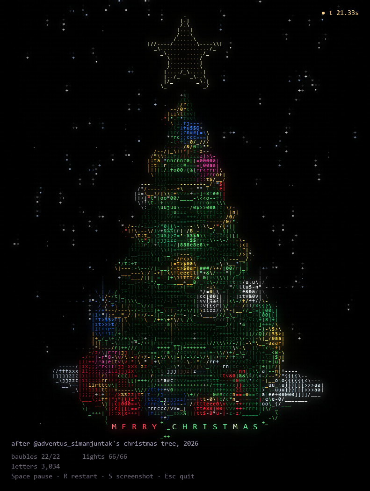

# Christmas Tree in ASCII 🎄

Pohon Natal yang tumbuh sendiri di layar — dirender huruf demi huruf, dengan lampu,
bauble, kado, salju, dan pesan yang diketik di bawahnya.




## Isi animasi

| Waktu | Yang terjadi |
| --- | --- |
| 0,35 – 0,45 s | tanah salju dan batang muncul |
| 0,5 – 3,1 s | pohon tumbuh tingkat demi tingkat dari bawah ke atas, ujung pertumbuhannya berkilau |
| 2,7 – 4,5 s | tinsel emas melilit pohon |
| 3,0 – 4,0 s | tiga kado mendarat di kaki pohon |
| 3,3 – 5,2 s | 22 bauble muncul satu per satu, dari bawah ke atas |
| 5,1 s | bintang di puncak menyala dengan kilatan dan percikan |
| 5,4 – 7,4 s | 66 lampu fairy menyala beruntun |
| 6,6 s | `M E R R Y  C H R I S T M A S` mulai diketik (10 huruf/detik) |
| 24 s | loop selesai, animasi mulai lagi |

Selama animasi berjalan, pohon bergoyang pelan, salju turun, langit berkelip, gelombang cahaya
naik melewati lampu tiap 5 detik, dan bintang melemparkan sinar secara berkala.

## Persyaratan

Isi [requirements.txt](requirements.txt):

```text
numpy>=1.24
pygame-ce>=2.5
opencv-python>=4.8        # hanya untuk ekspor video
```

`opencv-python` hanya dibutuhkan saat membuat video. Tanpa paket itu, animasi dan screenshot
tetap berjalan normal.

## Instalasi dan menjalankan

```bash
pip install -r requirements.txt

python christmas_tree.py            # memutar animasi
python christmas_tree.py --video    # merender satu loop ke tree_<timestamp>.mp4
```

## Kontrol

| Tombol | Fungsi |
| --- | --- |
| `Space` | pause / lanjutkan |
| `R` | mulai ulang dari awal |
| `S` | simpan screenshot `tree_<timestamp>.png` |
| `V` | rekam satu loop penuh ke `tree_<timestamp>.mp4` |
| `Esc` | keluar (atau batalkan perekaman video) |

## Ekspor video

Tekan `V` saat animasi berjalan, atau jalankan `python christmas_tree.py --video`.

- Animasi dirender ulang secara **offline** dengan clock tetap 30 FPS, jadi hasilnya mulus dan
  tidak bergantung pada kecepatan komputer saat memutar.
- Muncul progress bar di bagian bawah jendela; tekan `Esc` untuk membatalkan.
- Hasil: `tree_<timestamp>.mp4` di folder yang sama dengan skrip.
- Spesifikasi: 792 × 1050 piksel, 30 FPS, 720 frame (24 detik), codec MPEG-4 (`mp4v`),
  sekitar 24 MB.
- Setelah selesai, nama file muncul sebentar di pojok kanan bawah.

Contoh hasil ekspor: [tree_1794990892.mp4](tree_1794990892.mp4) (24 MB).

## Struktur file

| File | Keterangan |
| --- | --- |
| `christmas_tree.py` | seluruh animasi: geometri, pencahayaan, proyeksi, renderer, ekspor video |
| `requirements.txt` | dependensi Python |
| `rose_bouquet.py` | proyek asal yang menjadi acuan gaya |
| `preview.gif` | pratinjau animasi (340 × 451, 8 FPS) |
| `preview.png` | tangkapan layar hasil akhir |
| `tree_1794990892.mp4` | contoh video hasil `--video` |

## Catatan teknis

- Kanvas karakter: **113 × 105** sel, tiap sel **7 × 10** piksel → jendela **791 × 1050** px.
- Efek menyala dibuat dari dua lapis glow (blur sempit dan lebar) di atas gambar ASCII.
- Outline/stroke muncul otomatis di tepi objek dan di batas antar-part yang saling menutupi,
  sehingga bentuk pohon, bauble, dan kado tetap terbaca.
- Warna diambil dari palet kecil: hijau pinus, emas, merah, putih salju, dan biru malam.
- Bintang di puncak berupa poligon lima sudut; bagian dalamnya dibuat berongga agar bentuknya
  tetap jelas di grid karakter yang kasar.
- Video ditulis dengan OpenCV `VideoWriter` (frame BGR, lebar digenapkan ke 792 px).
